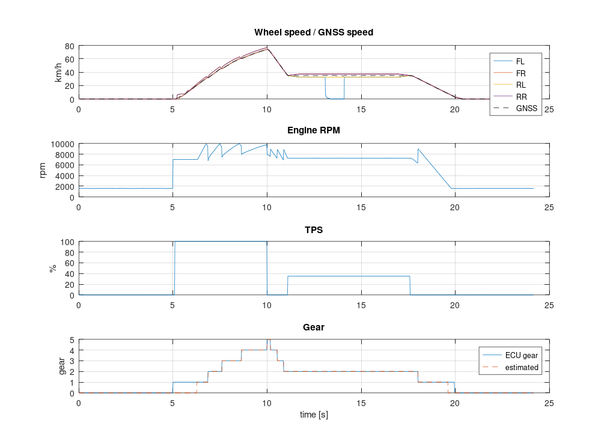
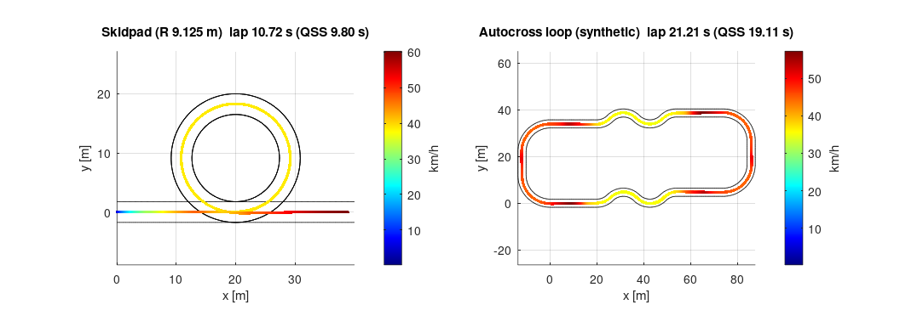

# prc27-virtual-track — Formula Student 가상 시험장과 고장 주입 CAN 로그

> MATLAB/Octave virtual test track for a Formula Student car: vehicle–driver–road–sensor models that emit raw CAN logs in the same format as the real logger, fault injection with known ground truth, log analyzers (wheel speed, TCS, gear, road dyno, steering, braking, fuel/ignition map review) and 72 self-checks. All results are synthetic. Docs in Korean.

실차 로그가 없는 동안 **정답을 아는 가짜 주행 로그**를 만들어 로그 분석 코드를 먼저 검증하려고 만든 코드 묶음입니다. 차량 값은 부산대 자작차 동아리 PARA의 PRC-26 설계보고서(2026 KSAE 제출본)에서 가져왔습니다.

## 구조

| 블록 | 파일 | 내용 |
|---|---|---|
| 차량 | `sim/vt_vehicle.m` | 평면 2트랙(vx·vy·요) + 바퀴 4개 회전 + 엔진·기어, 애커만 조향 LUT, 매직포뮬러 횡력·종 슬립, 마찰 타원, 하중 이동, 다운포스 |
| 운전자 | `sim/vt_driver.m` | 순수 추종 + 횡편차·방위 오차 피드백, 준정상상태 속도 프로파일 PI 추종 |
| 도로 | `sim/vt_road.m` | 스키드패드(R 9.125 m), 75 m 가속, 오토크로스 루프 250 m |
| 센서 → 로그 | `sim/prc_make_frames.m`, `dbc/` | IMU(장착 오차)·톤휠 에지 휠속도·SAS·BPS·ECU → **원본 CAN 로그 CSV** |
| 분석기 | `analysis/` | 로그 디코딩·품질 점검, TCS 재계산, 로드 다이노, 조향 특성, 제동, 연료맵 가이드, 점화맵 점검 |
| 랩타임 | `sim/laptime_qss.m` | 점질량 + GGV 준정상상태 |

## 일부러 넣는 고장과 탐지 (seed 1)

| 주입 | 탐지 방법 | 결과 |
|---|---|---|
| FL 휠센서 1.0 s 끊김(선회 중) | 같은 축 좌우 비교 | 13.09~14.09 s 탐지, 기준 차속을 FR로 대체 |
| 서스펜션 메시지 60 ms 연속 누락 | 기대 주기 대비 공백 | 최대 공백 70 ms |
| 전체 프레임 0.3 % 무작위 누락 | 순번 건너뜀 | 순번 있는 메시지는 주입 수와 정확히 일치 |
| NTC 온도센서 단선 | 무효 코드 0xFFF → NaN | 100 % 무효 |

## 검증

2026-10-04 GNU Octave 11.3.0에서 **72/72 통과**: 답을 아는 입력 32개 + 정답 재현 28개(연료맵·점화맵 등) + 가상 시험장 자기 일관성 12개. 실행 기록: [`docs/test_result_20261004.txt`](docs/test_result_20261004.txt). MATLAB 실행은 확인하지 않았습니다.

| 시험 | 2트랙 + 운전자 | QSS 상한 |
|---|---:|---:|
| 75 m 가속 | 5.23 s | 4.68 s |
| 스키드패드 2바퀴 | 10.72 s | 9.80 s |
| 오토크로스 루프 250 m | 21.21 s | 19.11 s |

## 실행

- MATLAB: 이 폴더에서 `run_all`
- GNU Octave(Windows): `Octave로_실행.cmd`
- 결과는 `out/`에 생깁니다(저장소에는 넣지 않음). 전체 약 10분, `run_all.m` 맨 위 스위치로 가상 시험장을 끄면 약 1분 반.

## 한계

- **모든 결과는 가상 데이터입니다.** 차량 성능·TCS 효과·변속점 판단에 그대로 쓰지 않습니다.
- 타이어 횡특성, 요 관성, 엔진 관성은 가정값입니다. 서스펜션 운동학·캠버 변화·롤/피치 자유도는 없습니다.
- 설계보고서 값은 CAD·계산값이며 실차 실측이 아닙니다.

자세한 설명은 [`README_CLAUDE.md`](README_CLAUDE.md)에 있습니다.

## 만든 과정

목적, 차량 값의 출처(설계보고서), 검증 도구(MATLAB이 없어 Octave)는 LDY0427이 정했고, 모델·분석기·테스트 코드는 Claude Code(AI 에이전트)가 작성했습니다. 공개본에서는 같은 동아리 다른 팀의 설계값을 뺐습니다.

## 라이선스

MIT
